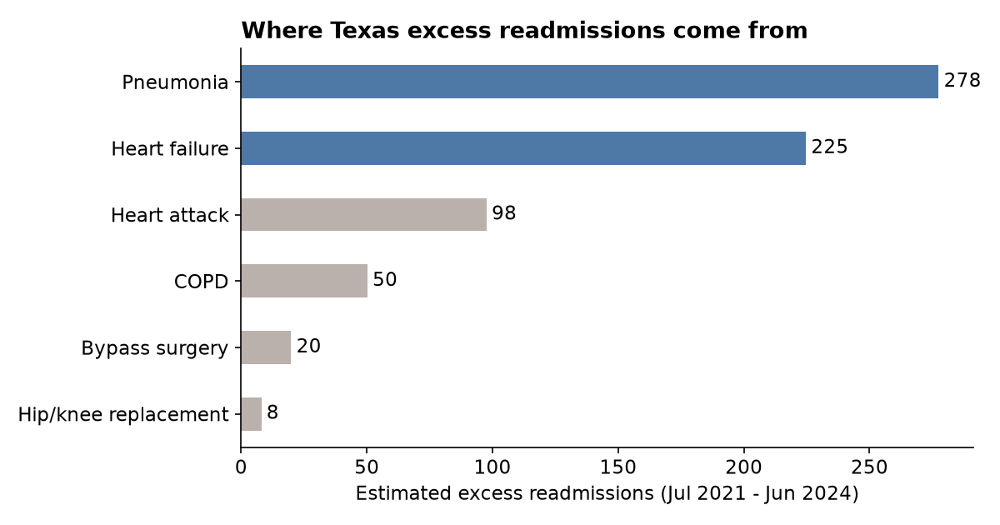
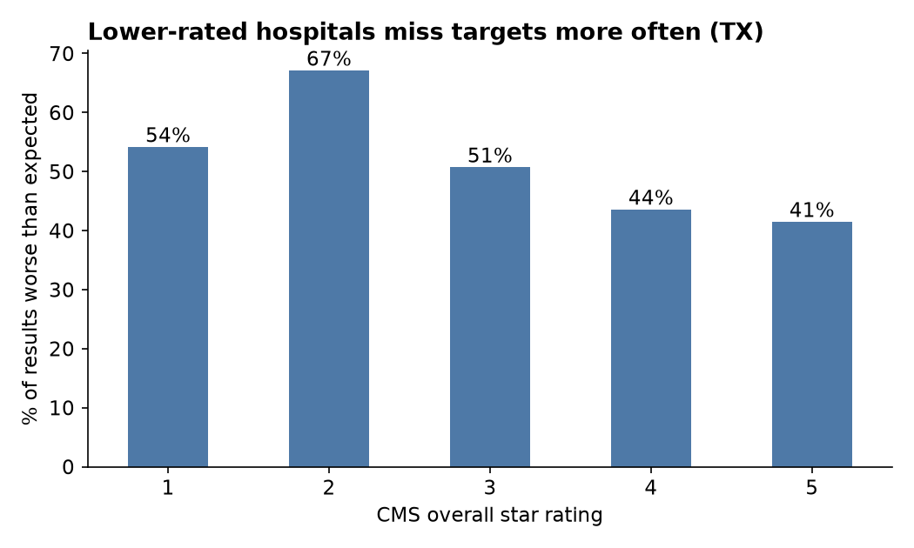

# Texas Hospital Readmissions: Where the Excess Comes From

**Question:** Medicare cuts payments to hospitals that readmit too many patients within 30 days (the Hospital Readmissions Reduction Program, HRRP). Which conditions and which Texas hospitals drive the most excess readmissions, and where should an improvement team start?

**Data:** Real, public CMS file: [FY 2026 Hospital Readmissions Reduction Program](https://data.cms.gov/provider-data/dataset/9n3s-kdb3), joined to [Hospital General Information](https://data.cms.gov/provider-data/dataset/xubh-q36u). 3,055 hospitals x 6 conditions = 18,330 rows. Performance period: July 2021 - June 2024.

**Tools:** SQL (SQLite) for cleaning and analysis, Tableau for the dashboard.

**Key metric:** Excess Readmission Ratio (ERR) = predicted readmission rate / expected rate. Above 1.0 = more readmissions than CMS expects for that hospital's patients.
I also estimated **excess readmissions** = discharges x (predicted rate - expected rate). This turns a ratio into a count of patients, which is easier to prioritize.

---

## Key findings

1. **Texas looks like the rest of the country overall.** 49.6% of Texas hospital-condition results are worse than expected vs. 48.0% elsewhere. The problem is not statewide; it is concentrated.

2. **Two conditions make up 74% of Texas excess readmissions.** Pneumonia (278) and heart failure (225) out of ~678 total. Hip/knee replacement and bypass surgery together are under 30.



3. **80 hospitals are worse than expected on 3+ conditions, and they hold 71% of the excess** (483 of 678). The top 20 hospitals alone account for 48%.

4. **One result can dominate a hospital's total.** Texoma Medical Center (Denison) ranks #1 mostly because of pneumonia: ERR 1.17 on 1,026 discharges = ~31 excess readmissions from one condition. That points to a specific program to fix, not a whole-hospital problem.

5. **Star rating lines up with readmissions.** 2-star Texas hospitals are worse than expected on 67% of their results vs. 41% for 5-star. For-profit hospitals are worse on 57% vs. 47% for non-profit.



## Recommendations

- Start with pneumonia and heart failure discharge planning at the 20 hospitals with the most excess. That covers about half the statewide excess.
- Rank hospitals by excess readmissions (patients), not just ERR. A 1.17 ratio on 1,026 discharges matters more than a 1.30 ratio on 40.
- For Austin: St. David's Medical Center, North Austin Medical Center and Ascension Seton Medical Center Austin are all above expected on pneumonia. A shared post-discharge follow-up program could target one condition across all three.

## How I did it

| Step | File | What it does |
|---|---|---|
| 1 | `sql/01_load.sql` | Imports the CMS CSVs into SQLite |
| 2 | `sql/02_clean.sql` | Converts "N/A" and "Too Few to Report" to NULL, renames measures, joins ownership and star rating, calculates excess readmissions |
| 3 | `sql/00_data_checks.sql` | Row counts, unmatched hospitals, usable rows, ratio range |
| 4 | `sql/03_analysis.sql` | Texas vs. US, condition breakdown, hospital rollup, top-20 concentration with window functions, ownership, star rating |
| 5 | `sql/04_export.sql` | Writes CSVs for Tableau |

SQL concepts used: `CASE` mapping, `LEFT JOIN`, `ALTER TABLE` + `UPDATE` for a calculated column, `GROUP BY ... HAVING`, `ROW_NUMBER()` and `SUM() OVER ()` for a running share.

**Data quality notes**
- Only 898 of 1,704 Texas rows have a ratio. CMS hides results for small volumes, so many rural hospitals drop out.
- 313 of those 898 have a ratio but "N/A" discharges, so they count toward the % worse but not the excess readmission totals. The excess numbers are a floor, not a full count.
- 20 hospitals in the HRRP file do not match the hospital info file (closed or renamed). They keep their results but have no ownership or rating.

## Run it yourself

```bash
sqlite3 readmissions.db < sql/01_load.sql
sqlite3 readmissions.db < sql/02_clean.sql
sqlite3 readmissions.db < sql/00_data_checks.sql
sqlite3 readmissions.db < sql/03_analysis.sql
sqlite3 readmissions.db < sql/04_export.sql
```

README charts are made by `charts.py` (pandas + matplotlib) from the output CSVs.

Tableau dashboard: see [tableau/README.md](tableau/README.md)

## Limitations

- Data is 2021-2024, and CMS risk-adjusts for patient mix. A ratio above 1.0 is a signal, not proof of poor care.
- Excess readmissions are estimated from published rates, so they are approximate.
